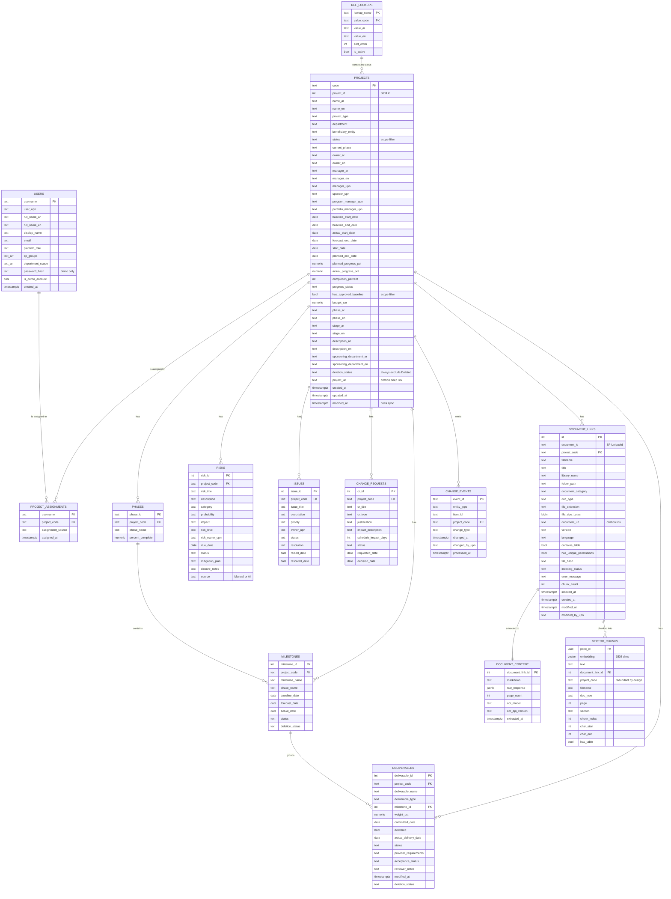

# SPM Data Model — End-to-End ERD (UC3 Enterprise Assistant)

**Sources reconciled in this document**

| | |
|---|---|
| Schema spec | `NCGR_AI_SPM_Input_Data_Schema_per_UseCase_v0.3`, sheet **UC3 Enterprise Assistant** — المساعد الرقمي للمؤسسة (لكل مشروع) |
| Built system | This repository: `infra/postgres-spm/migrations/001–017`, `pipeline/`, `Application/` |
| Field count | **119 fields across 11 SPM entities** — 67 required (R), 52 optional (O) |

This is the **target** model: every SPM entity UC3 consumes, mapped onto the
storage we actually run. Tables already built are marked ✅; tables the full
UC3 feed requires but we have not built yet are marked 🔶.

---

## 1. The end-to-end picture

```
┌─ SPM / Enjaz (SharePoint + Project Server) ─ READ ONLY ─────────────┐
│  PRJ  SCH  MIL  DEL  RSK  ISS  CR  DOC  USR  EVT  REF               │
└──────────────────────────┬──────────────────────────────────────────┘
                           │  15 mock REST APIs (DefaultResponse wrapper)
                           │  initial load + event-driven delta (EVT)
                           ▼
┌─ Our PostgreSQL — the SPM mirror ───────────────────────────────────┐
│  projects · phases · milestones · deliverables · risks · issues     │
│  change_requests · document_links · document_content                │
│  users · project_assignments · change_events · ref_lookups          │
│  Row-Level Security: one project per transaction, SELECT-only role  │
└──────────────────────────┬──────────────────────────────────────────┘
                           │  extract → chunk → embed
                           ▼
┌─ Qdrant — one collection per project ───────────────────────────────┐
│  project_<code> : vector(1536) + payload                            │
└─────────────────────────────────────────────────────────────────────┘
```

**Two stores, one boundary.** Structured facts answer "what is the budget";
document passages answer "what did the charter say". Both are filtered by
project before the model sees anything.

---

## 2. ERD



---

## 3. Entity-by-entity mapping

Type column shows **SPM type → PostgreSQL type**.
Status: ✅ built · 🔶 to build · ➕ column to add to an existing table.

### PRJ — Project (المشروع) ✅ table exists, ➕ 17 columns to add
`Source: SharePoint list "Projects"` ·
`Filter: DeletionStatus ne 'Deleted' AND status = Active AND approved baseline exists AND project in user's authorized list` ·
`Sync: initial load + event`

| SPM field | Type | R/O | Our column | Status |
|---|---|---|---|---|
| projectId | int → INTEGER | R | `project_id` | ➕ |
| projectCode | string → TEXT | R | `code` **PK** | ✅ |
| projectNameAr | string → TEXT | R | `name_ar` | ✅ |
| projectNameEn | string → TEXT | O | `name_en` | ✅ |
| projectType | choice → TEXT | O | `project_type` | ➕ |
| department | lookup → TEXT | O | `department` | ➕ |
| beneficiaryEntity | string → TEXT | O | `beneficiary_entity` | ➕ |
| status | choice → TEXT | R | `status` | ✅ |
| currentPhase | string → TEXT | R | `phase_ar` / `phase_en` | ✅ |
| projectManager | person → TEXT | R | `manager_ar`/`manager_en`/`manager_upn` | ✅ ➕upn |
| projectOwner | person → TEXT | O | `owner_ar` / `owner_en` | ✅ |
| projectSponsor | person → TEXT | O | `sponsor_upn` | ➕ |
| programManager | person → TEXT | O | `program_manager_upn` | ➕ |
| portfolioManager | person → TEXT | O | `portfolio_manager_upn` | ➕ |
| baselineStartDate | date → DATE | O | `baseline_start_date` | ➕ |
| baselineEndDate | date → DATE | O | `baseline_end_date` | ➕ |
| actualStartDate | date → DATE | O | `actual_start_date` | ➕ |
| forecastEndDate | date → DATE | O | `forecast_end_date` | ➕ |
| plannedProgressPct | decimal → NUMERIC | O | `planned_progress_pct` | ➕ |
| actualProgressPct | decimal → NUMERIC | O | `actual_progress_pct` | ➕ |
| progressStatus | choice → TEXT | O | `progress_status` | ➕ |
| hasApprovedBaseline | bool → BOOLEAN | **R** | `has_approved_baseline` | ➕ |
| deletionStatus | string → TEXT | **R** | `deletion_status` | ➕ |
| projectUrl | url → TEXT | **R** | `project_url` | ➕ |
| modifiedAt | datetime → TIMESTAMPTZ | **R** | `modified_at` | ➕ |

> Our extra columns — `budget_sar`, `stage_ar/en`, `completion_percent`,
> `description_ar/en`, `sponsoring_department_ar/en`, `start_date`,
> `planned_end_date` — have no UC3 equivalent. They drive the
> `project_overview` answer. **Ask the Enjaz team which SPM fields they map
> to**; `budget_sar` in particular is not in UC3 and the BRD quotes budget as
> an input, so it is likely an unlisted field.

### SCH — Schedule baseline & phases 🔶
`Source: Project Server (PWA), ProjectId = ProjectGUID` · `Sync: event / daily`

| SPM field | Type | R/O | Our column |
|---|---|---|---|
| phaseId | string → TEXT | O | `phases.phase_id` **PK** |
| phaseName | string → TEXT | O | `phases.phase_name` |
| percentComplete | decimal → NUMERIC | O | `phases.percent_complete` |

### MIL — Milestone (المعالم الرئيسية) 🔶
`SP name: Milestones` · `Filter: ProjectCode eq '{code}' AND DeletionStatus ne 'Deleted'`

| SPM field | Type | R/O | Our column |
|---|---|---|---|
| milestoneId | int → INTEGER | O | `milestone_id` **PK** |
| projectCode | string → TEXT | **R** | `project_code` **FK** |
| milestoneName | string → TEXT | **R** | `milestone_name` |
| phaseName | string → TEXT | O | `phase_name` |
| baselineDate | date → DATE | O | `baseline_date` |
| forecastDate | date → DATE | O | `forecast_date` |
| actualDate | date → DATE | O | `actual_date` |
| status | choice → TEXT | **R** | `status` |
| deletionStatus | string → TEXT | **R** | `deletion_status` |

### DEL — Deliverable (مخرجات المشروع) 🔶
`SP name: TBC (Deliverables)` · `Sync: event on add / update / status change`

| SPM field | Type | R/O | Our column |
|---|---|---|---|
| deliverableId | int → INTEGER | **R** | `deliverable_id` **PK** |
| projectCode | string → TEXT | **R** | `project_code` **FK** |
| deliverableName | string → TEXT | **R** | `deliverable_name` |
| deliverableType | choice → TEXT | O | `deliverable_type` |
| milestoneId | lookup → INTEGER | O | `milestone_id` **FK** |
| weightPct | decimal → NUMERIC | O | `weight_pct` |
| committedDate | date → DATE | **R** | `committed_date` |
| delivered | bool → BOOLEAN | **R** | `delivered` |
| actualDeliveryDate | date → DATE | O | `actual_delivery_date` |
| status | choice → TEXT | **R** | `status` |
| providerRequirements | text → TEXT | O | `provider_requirements` |
| acceptanceStatus | choice → TEXT | O | `acceptance_status` |
| reviewerNotes | text → TEXT | O | `reviewer_notes` |
| modifiedAt | datetime → TIMESTAMPTZ | **R** | `modified_at` |
| deletionStatus | string → TEXT | **R** | `deletion_status` |

### RSK — Risk (المخاطر) 🔶
`SP name: Risks` · `Filter: ProjectCode eq '{code}'`

| SPM field | Type | R/O | Our column |
|---|---|---|---|
| riskId | int → INTEGER | **R** | `risk_id` **PK** |
| projectCode | string → TEXT | **R** | `project_code` **FK** |
| riskTitle | string → TEXT | **R** | `risk_title` |
| description | text → TEXT | **R** | `description` |
| category | choice → TEXT | O | `category` |
| probability | choice → TEXT | O | `probability` |
| impact | choice → TEXT | O | `impact` |
| riskLevel | choice → TEXT | **R** | `risk_level` |
| riskOwner | person → TEXT | **R** | `risk_owner_upn` |
| dueDate | date → DATE | **R** | `due_date` |
| status | choice → TEXT | **R** | `status` |
| mitigationPlan | text → TEXT | **R** | `mitigation_plan` |
| closureNotes | text → TEXT | O | `closure_notes` |
| source | choice → TEXT | O | `source` |

### ISS — Issue (العوائق / القضايا) 🔶
`SP name: Issues`

| SPM field | Type | R/O | Our column |
|---|---|---|---|
| issueId | int → INTEGER | **R** | `issue_id` **PK** |
| projectCode | string → TEXT | **R** | `project_code` **FK** |
| issueTitle | string → TEXT | **R** | `issue_title` |
| description | text → TEXT | **R** | `description` |
| priority | choice → TEXT | **R** | `priority` |
| owner | person → TEXT | **R** | `owner_upn` |
| status | choice → TEXT | **R** | `status` |
| resolution | text → TEXT | **R** | `resolution` |
| raisedDate | date → DATE | O | `raised_date` |
| resolvedDate | date → DATE | O | `resolved_date` |

### CR — Change request (طلبات التغيير) 🔶

| SPM field | Type | R/O | Our column |
|---|---|---|---|
| crId | int → INTEGER | **R** | `cr_id` **PK** |
| projectCode | string → TEXT | **R** | `project_code` **FK** |
| crTitle | string → TEXT | **R** | `cr_title` |
| crType | choice → TEXT | **R** | `cr_type` |
| justification | text → TEXT | **R** | `justification` |
| impactDescription | text → TEXT | O | `impact_description` |
| scheduleImpactDays | int → INTEGER | O | `schedule_impact_days` |
| status | choice → TEXT | **R** | `status` |
| requestedDate | date → DATE | O | `requested_date` |
| decisionDate | date → DATE | O | `decision_date` |

### DOC — Project document (وثائق المشروع) ✅ table exists, ➕ 11 columns
`Source: SharePoint document libraries (approved libraries per DEP-03)` ·
`Filter: approved libraries only; active projects; security-trimmed per user`

| SPM field | Type | R/O | Our column | Status |
|---|---|---|---|---|
| documentId | string → TEXT | **R** | `document_id` (SP UniqueId) | ➕ |
| projectCode | string → TEXT | **R** | `project_code` **FK** | ✅ |
| fileName | string → TEXT | **R** | `filename` | ✅ |
| title | string → TEXT | **R** | `title` | ➕ |
| libraryName | string → TEXT | **R** | `library_name` | ➕ |
| folderPath | string → TEXT | O | `folder_path` | ➕ |
| documentCategory | choice → TEXT | O | `document_category` (we have `doc_type`) | ➕ |
| fileExtension | string → TEXT | **R** | `file_extension` | ➕ |
| fileSizeBytes | int → BIGINT | O | `file_size_bytes` | ✅ |
| documentUrl | url → TEXT | **R** | `document_url` | ➕ |
| version | string → TEXT | **R** | `version` | ➕ |
| createdAt | datetime → TIMESTAMPTZ | O | `created_at` | ✅ |
| modifiedAt | datetime → TIMESTAMPTZ | **R** | `modified_at` | ➕ |
| modifiedBy | person → TEXT | O | `modified_by_upn` | ➕ |
| content | binary → *(not stored)* | **R** | → `document_content.markdown` | ✅ |
| hasUniquePermissions | bool → BOOLEAN | **R** | `has_unique_permissions` | ➕ |

> **`content` is deliberately not stored as bytes.** The file is fetched,
> extracted to markdown by Document Intelligence, and the markdown is cached
> in `document_content`. Storing both the original bytes and the extraction
> doubles storage for no retrieval benefit — but note the SPM contract still
> requires *fetching* the bytes (API-12).
>
> **`hasUniquePermissions` is the one that changes the security model.**
> Today AC09 is project-level. A document with item-level permissions needs
> per-document trimming *inside* a project — an open question on the sheet
> (Q5) and not yet designed.

### DOCUMENT_CONTENT ✅ (ours, no SPM equivalent)
The OCR cache. Its existence is the "extraction done" marker, so an
unchanged corpus is never re-billed.

| Column | Type |
|---|---|
| document_link_id | INTEGER **PK FK** |
| markdown | TEXT |
| raw_response | JSONB |
| page_count | INTEGER |
| ocr_model | TEXT |
| ocr_api_version | TEXT |
| extracted_at | TIMESTAMPTZ |

### USR — User access scope (صلاحيات المستخدم) ✅ tables exist, ➕ 5 columns
`Source: AD + SharePoint groups + project person fields` ·
`Sync: at login + scheduled refresh`

| SPM field | Type | R/O | Our column | Status |
|---|---|---|---|---|
| userUpn | string → TEXT | **R** | `users.user_upn` | ➕ |
| displayName | string → TEXT | O | `users.display_name` | ➕ |
| email | string → TEXT | O | `users.email` | ✅ |
| spGroups | string[] → TEXT[] | **R** | `users.sp_groups` | ➕ |
| platformRole | choice → TEXT | **R** | `users.platform_role` | ➕ |
| assignedProjectCodes | string[] → *rows* | **R** | `project_assignments` | ✅ |
| departmentScope | string[] → TEXT[] | O | `users.department_scope` | ➕ |

> **`assignedProjectCodes` is an array in SPM and a table here, deliberately.**
> `project_assignments` **is** the AC09 boundary — a project with no row is
> invisible by construction, and Row-Level Security policies can reference a
> table but not an array held in the application.

### EVT — Change event (حدث تغيير) 🔶
`Source: webhook / delta feed (TBC)` · `Sync: push or poll`

| SPM field | Type | R/O | Our column |
|---|---|---|---|
| eventId | string → TEXT | **R** | `event_id` **PK** (idempotency) |
| entityType | choice → TEXT | **R** | `entity_type` |
| itemId | string → TEXT | **R** | `item_id` |
| projectCode | string → TEXT | **R** | `project_code` **FK** |
| changeType | choice → TEXT | **R** | `change_type` |
| changedAt | datetime → TIMESTAMPTZ | **R** | `changed_at` |
| changedBy | person → TEXT | O | `changed_by_upn` |
| — | — | — | `processed_at` *(ours: replay guard)* |

> **This replaces our daily 13:00 schedule.** We re-scan the whole corpus
> nightly; UC3 requires event-driven sync (BR-9 / EPC-03). `event_id` must be
> the idempotency key — a webhook that delivers twice must not re-index twice.

### REF — Reference lookups (القوائم المرجعية) 🔶

| SPM field | Type | R/O | Our table |
|---|---|---|---|
| projectStatusValues | choice list | **R** | `ref_lookups` where `lookup_name='project_status'` |
| departments | lookup list | O | `ref_lookups` where `lookup_name='department'` |
| documentCategories | choice list | O | `ref_lookups` where `lookup_name='document_category'` |

> **One table, not three.** `(lookup_name, value_code)` composite PK, with
> `value_ar` / `value_en`. This is what feeds "Status (Arabic)" into the
> prompt so the model never translates a status itself — the defect recorded
> in STATUS_AND_ROADMAP §24h.

---

## 4. Vector store (Qdrant) — not in the Excel, required by the solution

One collection per project: `project_<projectCode>`. Cross-project retrieval
is not filtered out — it is not addressable.

| Payload field | Type | Source |
|---|---|---|
| `text` | string | chunk body |
| `page` | int | OCR page number |
| `section` | string | nearest heading |
| `chunk_index` | int | ordinal within document |
| `char_start` / `char_end` | int | offsets into `document_content.markdown` |
| `has_table` | bool | chunk contains a table |
| `document_link_id` | int | → `document_links.id` |
| `project_code` | string | redundant by design — a second check |
| `filename` | string | citation display |
| `doc_type` | string | citation display |

Vector: **1536 dimensions**, cosine, `text-embedding-3-S`.

---

## 5. What this means for the build

### Already built ✅
`projects` · `users` · `project_assignments` · `document_links` ·
`document_content` · per-project Qdrant collections · Row-Level Security ·
the access gate.

### To add 🔶 — 8 new tables
`phases` · `milestones` · `deliverables` · `risks` · `issues` ·
`change_requests` · `change_events` · `ref_lookups`

Each needs the same treatment as `document_links`:
`ENABLE ROW LEVEL SECURITY`, a `project_scope` policy on `project_code`, and
`GRANT SELECT` to `spm_app`. **A new table without a policy is readable
across every project** — RLS is per-table, not per-database.

### Columns to add ➕
17 on `projects`, 11 on `document_links`, 5 on `users`.

### Four decisions needed from the Enjaz team
1. **`budget_sar` is not in UC3**, yet the BRD quotes budget as an input and
   our assistant answers budget questions. Which SPM field carries it?
2. **`hasUniquePermissions`** — per-document trimming inside a project is not
   designed. Open question Q5 on the sheet.
3. **Event-driven sync vs our nightly schedule** — Q3 on the sheet
   (webhook or delta poll) decides whether `change_events` is push or pull.
4. **Exact SharePoint list and field names** — 60+ fields are marked
   `TBC`/`N` (not confirmed). Canonical names here are the Excel's camelCase;
   the real internal names are still to be filled in the yellow columns.

### A structural note on the new entities
Risks, issues, change requests, deliverables and milestones are **structured
rows, not documents**. They should reach the model the way the project record
does — as a labelled block in the prompt — **not** be chunked and embedded.
Embedding a risk register row loses the field structure that makes it
answerable, and the model already handles a structured block well. Retrieval
is for prose; SQL is for rows.
